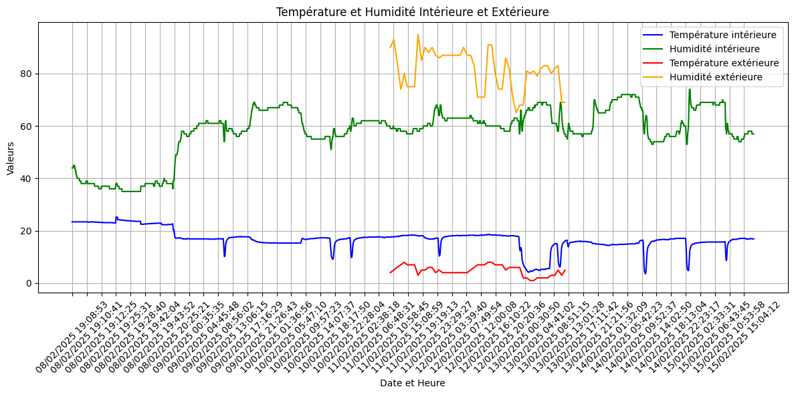

# HumidityHouse

A small sensor project to find out where the humidity in a house comes from, and when. Sensors log temperature and humidity, and a Python script compares indoor and outdoor readings over time.

## Hardware

- Arduino Uno, DHT11 sensor, SD card module and DS1307 RTC module (offline logging)
- ESP32 (online logging over Wi-Fi)
- Jumper wires and a breadboard

## Files

| File | What it does |
|---|---|
| `ArduinoCode_SDCard.ino` | Arduino Uno: reads the DHT11 every minute, timestamps it with the RTC and appends it to `data.csv` on the SD card |
| `CodeArduinoforWIFI.ino` | ESP32: reads the sensor and sends the values to a Firebase Realtime Database over Wi-Fi |
| `AppsScriptsforWIFI.gs` | Google Apps Script: pulls the latest Firebase values and appends them to a Google Sheet |
| `DataScience.py` | pandas and matplotlib: plots indoor against outdoor temperature and humidity, skipping long gaps in the data |

## How to run

1. Open the `.ino` file in the Arduino IDE and install the DHT and RTClib libraries (plus SD for the offline version).
2. For the ESP32 version, replace the Wi-Fi placeholders and the Firebase URL with your own values. Never commit real credentials.
3. For the analysis, export the readings to `combined_data23.csv` and run `python DataScience.py`.

## Next steps

- Circuit diagram
- Correlate humidity peaks with activity (showers, cooking, ventilation)
